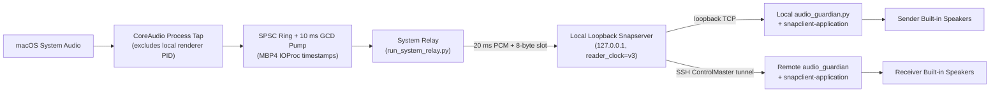

# Macbee Architecture

Macbee shares synchronized Entire Mac audio from one Apple Silicon sender Mac to up to 16 selected Apple Silicon Macs (the sender's own speakers plus configured remote receivers) over the local network and SSH — with **no virtual audio driver** on the sender and **no pre-installed app or Homebrew packages** on receivers.

Both the sender's local speakers and every remote Mac play from the **same buffered Snapcast timeline** (500 ms receiver buffer), rather than combining immediate local passthrough with delayed remote playback.

---

## End-to-End Audio & Control Pipeline

---

## Key Subsystems

### 1. Zero-Driver System Capture & Feedback Exclusion
- **Files:** `Sources/ControlledCapture/ControlledCapture.m`, `SystemAudioSource.m`, `ApplicationSession.m`, `Sources/AudioPipeline/pcm_ring.{h,c}`
- Uses Apple's public CoreAudio Process Tap API (`CATapDescription` with `CATapMutedWhenTapped`) attached to a private, input-only aggregate device — no virtual audio driver or HAL plugin is installed.
- Before starting capture, `MBSystemAudioSource` pins the exact owned `[backend, guardian, renderer]` process lineage and CoreAudio process object ID of Macbee's own local `snapclient-application`, excluding it from the global tap to prevent feedback loops.
- If the local renderer exits or changes identity, sharing stops cleanly rather than guessing a replacement process.

### 2. Timestamped Capture & Bounded Pacing Recovery (`MBP4` / `reader_clock=v3`)
- **Files:** `Sources/ControlledCapture/ApplicationSession.m`, `tools/run_system_relay.py`, `tools/reader_clock.py`, `tools/snapserver_clock_patch.py`, `tools/snapcast_qos_patch.py`
- The CoreAudio IOProc records each callback's hardware input timestamp (converted to sleep-excluding uptime nanoseconds, with a monotonic `<= 20 ms` cycle-projection clamp) alongside PCM frames in a preallocated 32,768-frame lock-free SPSC ring.
- A dedicated 10 ms `QOS_CLASS_USER_INTERACTIVE` serial GCD pump drains the ring independently of the AppKit main loop and streams `MBP4` timestamped packets to the Python system relay.
- The relay feeds 20 ms (3,840-byte) 48 kHz 16-bit stereo PCM blocks prefixed with an 8-byte monotonic slot number to a locally bound, patched Snapcast `0.35.0` `snapserver` (`macbee_clock=v3`).
- Across brief sender pauses (250–580 ms), Macbee performs **bounded recovery**: expired sender backlog is dropped rather than burst-replayed, the server fills only missed 20 ms grid slots with silence and discards superseded late slots, and a rolling limit of 4 recoveries per 10 seconds fails closed (`sender_pacing_recovery_limit` / `server_pacing_recovery_limit`) instead of streaming silence indefinitely.
- Active sessions hold a `UserInitiated + LatencyCritical` process activity token and raise worker QoS in-process across the relay, Snapserver ASIO workers, and CoreAudio playback workers.

### 3. On-Demand Discovery, In-App SSH Sign-In & ControlMaster Reuse
- **Files:** `Sources/MacbeeApp/AddMacSheet.{h,m}`, `SSHBrowse.{h,m}`, `Sources/SSHLogin/{SSHSignIn,SSHControlMaster}.{h,m}`, `askpass.c`, `tools/ssh_discovery.py`, `tools/ssh_control.py`, `tools/receiver_setup.py`
- **Zero background activity on launch:** Bonjour browsing (`_ssh._tcp`), SSH config parsing, and the sign-in broker start only when explicitly opened by the user and stop immediately on close.
- **Safe discovery:** `~/.ssh/config` aliases (including `Include` directives) are parsed statically without executing `ssh -G` or `Match exec`; Bonjour browsing queries `_ssh._tcp` without advertising any service or opening a listener.
- **App-owned SSH prompt channel:** Interactive sign-in runs only system `/usr/bin/ssh` (or opt-in `/usr/bin/ssh-add --apple-use-keychain` when **Remember passphrase in Keychain** is ticked). The bundled `macbee-askpass` helper communicates over a `0700` directory / `0600` Unix-domain socket verified by peer UID, PID, executable path, and direct parent ancestry. Passwords and passphrases are never logged, persisted to disk, or passed in arguments/environment. Host keys require explicit SHA-256 fingerprint confirmation, changed host keys are refused, and Macbee never edits `known_hosts`.
- **Single sign-in per session:** Each authenticated receiver runs a foreground SSH ControlMaster in a short `0700` control directory (`/tmp/macbee-ctl.XXXXXXXX/%C`, strictly under macOS's 104-byte Unix socket path limit). All subsequent checks, staging, and audio forwarding calls run through `tools/ssh_control.py` with `BatchMode=yes`, `StrictHostKeyChecking=yes`, `UpdateHostKeys=no`, and `ControlMaster=no`. Every owned ControlMaster is closed with `ssh -O exit` on **Stop** and app quit.

### 4. Per-Output Safety Guardians, Leases & Cleanup
- **Files:** `tools/audio_guardian.py`, `Sources/tone_probe.c`, `tools/configured_transport.py`, `tools/relay_runtime.py`
- Every local and remote `snapclient-application` runs under `audio_guardian.py` with a 3-second renewable `PING` lease (buffered non-blocking heartbeat writes tolerate transient pipe/SSH backpressure). If the sender crashes or SSH drops, renderers self-terminate when their lease expires.
- `macbee-tone-probe --inspect` enforces 48 kHz Built-in Speaker default output with zero input streams (Macbee never opens a microphone) and tracks the stable CoreAudio `kAudioDevicePropertyDeviceUID` (`device_uid`) so transient macOS HAL plugin reloads (such as `AirPlayXPCHelper`) do not cause false disconnects.
- A remote receiver failure marks only that output **Offline** while other selected outputs continue playing. **Stop** and app exit always terminate renderers before releasing the tap, and `relay_runtime.py` prunes old completed `relay-*` directories on startup.

---

## Diagnostics, Privacy & License Boundary

- **Content-free local diagnostics:** Stop/failure evidence in `~/Library/Application Support/Macbee/diagnostics/latest-native.json` and `relay-runtime/` records fixed reason codes and timing/queue counters only — never audio samples, media titles, credentials, or host addresses.
- **Process isolation & licensing:** Native Macbee executables link only Apple system frameworks; modified Snapcast `0.35.0` binaries run as separate child processes over pipes and loopback TCP. Macbee and its bundled Snapcast modifications are licensed under **`GPL-3.0-or-later`** (see [`LICENSE`](../LICENSE), [`THIRD-PARTY-NOTICES.md`](../THIRD-PARTY-NOTICES.md), and [`RELEASE-BACKEND.md`](RELEASE-BACKEND.md)).
